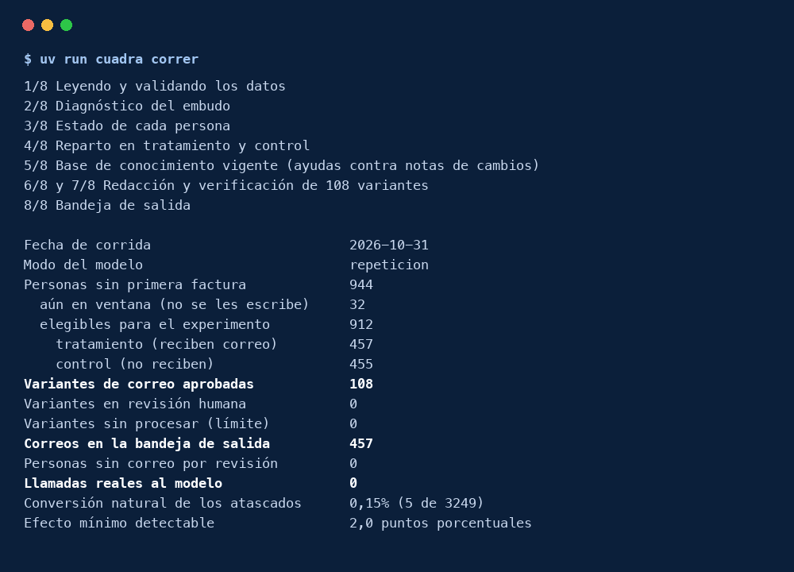
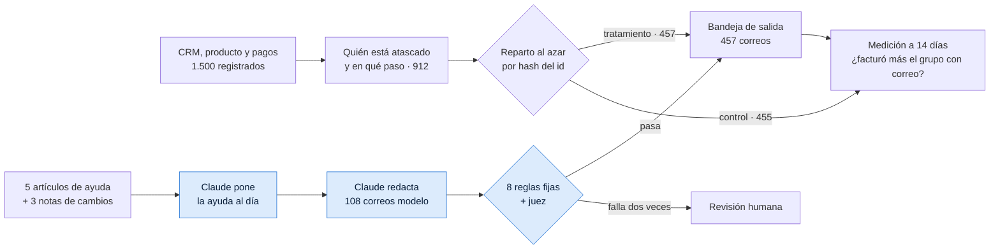
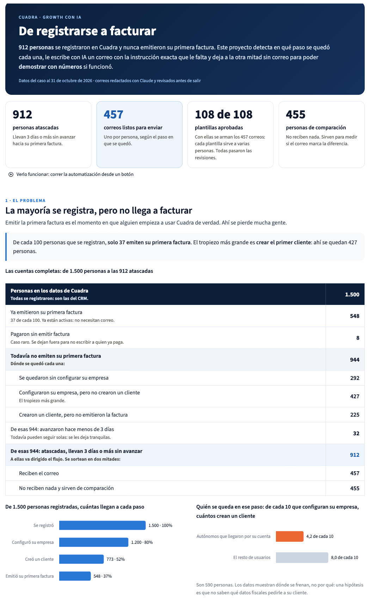
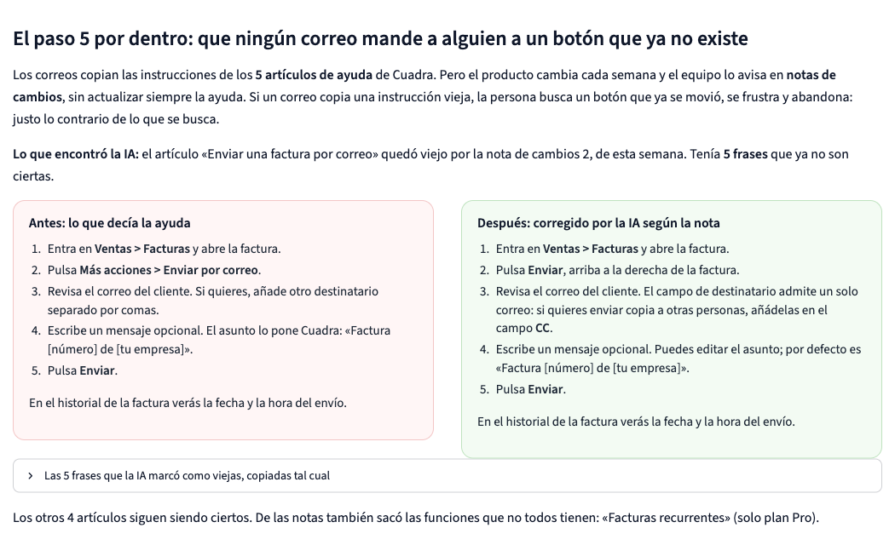
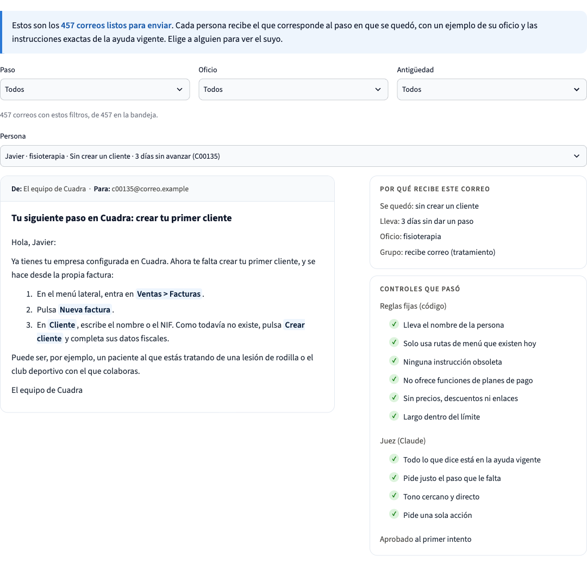
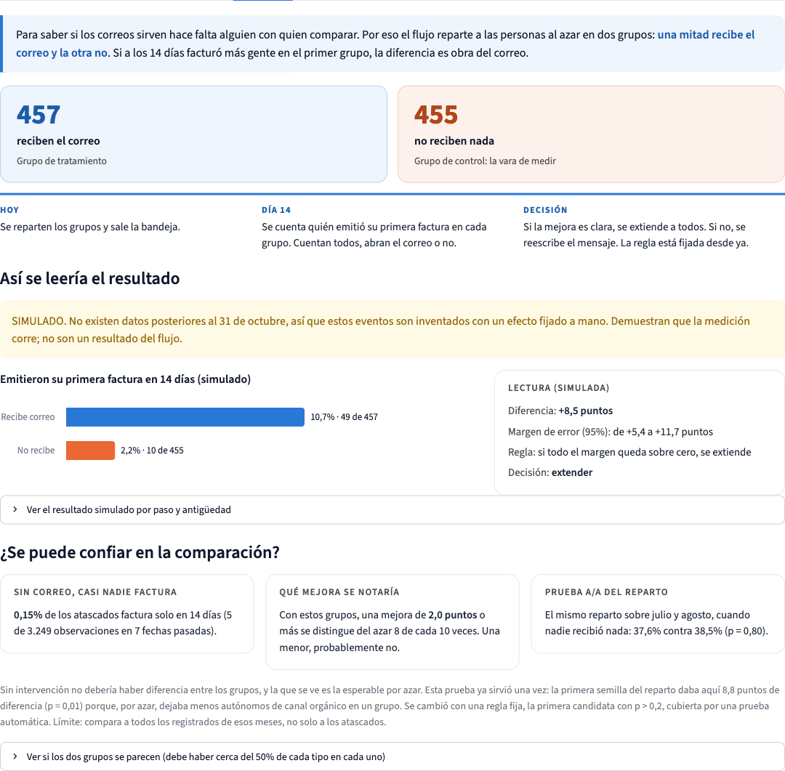

# Cuadra: de registrarse a facturar

Flujo con IA para el reto técnico Growth con IA. Lee las exportaciones de Cuadra (CRM, producto y pagos),
encuentra a las personas que se registraron y se quedaron antes de emitir su primera factura, y deja listo
un correo verificado para cada una, con un grupo de control para saber si el correo sirvió de algo.

El enunciado del caso está en [`ENUNCIADO.md`](ENUNCIADO.md).



Resumen de una página: [`docs/resumen-entrega.pdf`](docs/resumen-entrega.pdf).

## En 30 segundos

| | |
|---:|---|
| **912** | personas registradas que llevan 3 días o más atascadas antes de su primera factura |
| **1** | grupo concentra la fuga: autónomos de canal orgánico, solo el 42% crea su primer cliente |
| **108 de 108** | correos modelo redactados por Claude que pasaron la verificación (8 reglas fijas y un juez) |
| **1 de 5** | artículos de ayuda que Claude detectó como desactualizado por un cambio de esta semana |
| **457 y 455** | personas que reciben correo y personas de control, para medir si el correo sirve |
| **0** | claves o cuentas necesarias para reproducirlo: corre desde las respuestas guardadas |

## Cómo funciona



En azul, los pasos donde trabaja la IA. Todo lo demás es código: a quién se escribe y cómo se mide no lo
decide un modelo.

## Cómo correrlo

Hace falta [uv](https://docs.astral.sh/uv/). No hace falta ninguna clave ni cuenta.

```bash
uv sync                  # instala Python 3.12 y las dependencias
uv run cuadra correr     # corre el flujo completo; tarda unos segundos
uv run cuadra panel      # abre el panel web local con los resultados
```

Sin clave, el flujo repite las respuestas de Claude guardadas en `cache/` y produce exactamente los archivos
que ya están en `salida/`. Para que Claude redacte de nuevo:

```bash
cp .env.example .env     # y pon tu ANTHROPIC_API_KEY
uv run cuadra correr --modo vivo --forzar --limite-variantes 6   # 6 variantes, menos de 1 USD
git checkout cache salida   # vuelve a la corrida completa incluida en el repositorio
```

Para ver cómo se mediría el resultado, con datos inventados y marcados como tales:

```bash
uv run cuadra simular --efecto 0.08
uv run cuadra medir --eventos salida/SIMULADO_eventos_posteriores.csv
```

Pruebas: `uv run pytest` (sin red ni clave).

## Qué encontré

De 1500 personas registradas entre julio y octubre, 548 (37%) emitieron su primera factura y 205 (14%) pagaron.

1. **La fuga tiene nombre: autónomos que llegan por canal orgánico y no crean su primer cliente.** Son 590
   personas. Solo el 42% pasa de configurar su empresa a crear un cliente; en los otros siete cruces de canal
   y segmento lo hace entre el 72% y el 84%. Solo el 15% de ese grupo llega a facturar.
2. **Quien avanza, avanza rápido; quien se para, no vuelve solo.** Nadie emitió su primera factura más de 8
   días después de registrarse. De quienes llevaban 3 días o más sin dar un paso, solo 5 de 3249 (0,15%, sumando siete
   fechas de corte pasadas) facturaron en los 14 días siguientes. Hoy hay 912 personas en esa situación.
3. **Facturar predice pagar.** 197 de los 205 pagadores habían emitido una factura.
4. **El Centro de Ayuda está desactualizado en un punto.** Una nota de cambios de esta semana contradice el
   artículo «Enviar una factura por correo». Un flujo que repitiera ese artículo mandaría a la gente a un
   botón que ya no está ahí.



Detalle en [`salida/diagnostico.md`](salida/diagnostico.md).

## Qué hace el flujo

| Etapa | Qué hace | ¿Usa IA? |
|---|---|---|
| 1. Ingesta | Carga y valida los tres CSV; se detiene con un mensaje claro si algo no cuadra | No |
| 2. Diagnóstico | Embudo general y por canal, segmento y mes; días entre pasos | No |
| 3. Estado | En qué paso está cada persona sin factura y cuántos días lleva quieta | No |
| 4. Experimento | Reparte a las 912 elegibles en tratamiento (457) y control (455) con un hash de su id | No |
| 5. Base vigente | Compara cada artículo de ayuda con las notas de cambios y corrige lo obsoleto | Sí |
| 6. Redacción | Un correo por combinación de paso, oficio y antigüedad: 108 variantes | Sí |
| 7. Verificación | 8 reglas fijas y un juez; un rechazo da un segundo intento, dos mandan a revisión humana | Reglas no, juez sí |
| 8. Bandeja | Une cada correo aprobado con las personas del grupo de tratamiento | No |

La IA no repite instrucciones viejas. Esto es lo que encontró al cruzar la ayuda con las notas de la semana:



Y así queda un correo, con el motivo por el que esa persona lo recibe y los controles que pasó:



Resultado de la corrida incluida en el repositorio:

- La etapa 5 marcó como desactualizado solo el artículo 04 y citó sus cinco frases obsoletas.
- Las 108 variantes pasaron la verificación; 3 necesitaron el segundo intento.
- La bandeja tiene 457 correos y la cola de revisión humana está vacía.

Archivos en `salida/`:

| Archivo | Contenido |
|---|---|
| `bandeja_salida.csv` | Un correo por persona del grupo de tratamiento: destinatario, asunto y cuerpo |
| `asignacion_experimento.csv` | Las 912 personas elegibles, con su grupo y su fecha de entrada |
| `base_vigente.json` | Los artículos de ayuda tal como valen hoy, con lo obsoleto señalado |
| `variantes.json` | Las 108 plantillas, con el resultado de su verificación |
| `cola_revision.csv` | Variantes que una persona debe revisar antes de enviar |
| `diagnostico.md` | El embudo y el hallazgo principal |
| `prueba_aa.json` | Comprobación del reparto sobre julio y agosto |
| `SIMULADO_*` | Demostración de la medición con eventos inventados |

## Cómo sabría si funcionó



- **Comparación:** tratamiento (recibe correo) contra control (no recibe), repartidos al azar con un hash del
  identificador. Se cuenta a todas las personas asignadas, abran el correo o no.
- **Métrica principal:** porcentaje que emite su primera factura en los 14 días siguientes.
- **Secundarias:** avanza al menos un paso en 7 días; paga en 45 días.
- **De protección:** bajas y quejas. No existen en los datos del caso; habría que medirlas desde el primer envío.
- **Regla de decisión, escrita antes de mirar:** si el intervalo de confianza del 95% de la diferencia queda
  entero por encima de cero, se extiende a todos. Si no, se itera el mensaje por paso y antigüedad.
- **Qué se puede detectar:** con 457 y 455 personas y una conversión natural del 0,15%, una mejora de unos 2
  puntos o más, con potencia del 80% (aproximación normal). Una mejora menor probablemente no se distinguiría
  del azar.
- **Comprobación del reparto (prueba A/A):** el mismo hash aplicado a julio y agosto, cuando nadie recibió
  nada, no debe mostrar diferencia. La primera semilla que usé sí la mostraba (p = 0,01): por azar dejaba
  menos autónomos de canal orgánico en un grupo. La cambié con una regla fija, la primera candidata con
  p > 0,2, cubierta por una prueba automática. No hubo ningún envío real con la semilla anterior; el
  historial conserva la bandeja que se generó con ella. Límite de esta prueba: compara a todos los
  registrados de esos meses, no solo a los atascados.

`cuadra medir` calcula la métrica principal, total y por paso y antigüedad, sobre una exportación posterior
de eventos. Las métricas secundarias y las de protección están definidas pero no implementadas. Como no hay
datos después del 31 de octubre, `cuadra simular` inventa una para demostrar que el cálculo corre. **Ese resultado es simulado y
no dice nada sobre el efecto real del flujo.**

## Qué decidí y por qué

- **Escribir a quien lleva 3 días o más quieto, no antes.** Antes de eso la gente todavía avanza sola.
- **Una redacción por variante, no por persona.** El CRM solo trae nombre, canal, segmento y oficio; llamar al
  modelo 457 veces produciría los mismos 108 textos. Así cada plantilla se verifica entera y el nombre se
  inserta después.
- **La IA redacta y revisa; el código decide a quién se escribe y calcula las métricas.**
- **Verificación antes de salir.** Reglas fijas para lo que se puede comprobar sin opinar (rutas de menú que
  existen, nada obsoleto, nada de planes de pago, sin precios ni enlaces) y un juez para lo demás.
- **Respuestas guardadas en el repositorio.** La demostración no depende de la red ni de una cuota, y
  cualquiera puede reproducir la corrida sin clave.
- **Las facturas recurrentes no se mencionan.** Son solo del plan Pro y estas personas no tienen plan.

El razonamiento completo está en [`docs/2026-11-12-diseno-flujo-activacion.md`](docs/2026-11-12-diseno-flujo-activacion.md).

## Qué no cubre

- **No envía correos** ni mide aperturas o clics. Las direcciones del caso son ficticias.
- **No demuestra por qué** los autónomos de canal orgánico se atascan al crear un cliente. Hipótesis a
  investigar: no saben qué datos fiscales pedirle a su cliente.
- **El efecto real es desconocido** hasta 14 días después de un envío de verdad.
- **Los datos son sintéticos.** Que casi nadie avance solo pasado el tercer día puede ser un artefacto.
- **Sin consentimiento ni enlace de baja**, obligatorios en producción.
- **Un canal y un mensaje por persona.** Sin recordatorios ni avisos dentro del producto.
- **Ocho personas pagaron sin haber facturado.** Quedan fuera y listadas en `salida/pagadores_sin_factura.csv`.

## Herramientas y costo

- Construido con Claude Code. El historial de commits sigue el plan de [`docs/2026-11-12-plan-construccion.md`](docs/2026-11-12-plan-construccion.md).
- El flujo llama a Claude (`claude-opus-5-5`) con el SDK oficial de Anthropic y salidas estructuradas.
- El caché guarda 228 respuestas de Claude. Generarlo costó aproximadamente 5 USD; durante el desarrollo se
  gastaron unos 3,5 USD más en una corrida repetida por error. Repetir la corrida desde el caché no cuesta nada.

## Estructura

```
cuadra/      el flujo: un módulo por etapa, más cli.py y modelo.py (cliente de Claude con caché)
panel/       panel web (Streamlit)
datos/ ayudas/ notas/   material del caso
cache/       respuestas de Claude guardadas
salida/      resultados de la última corrida
tests/       pruebas
docs/        diseño y plan
```
